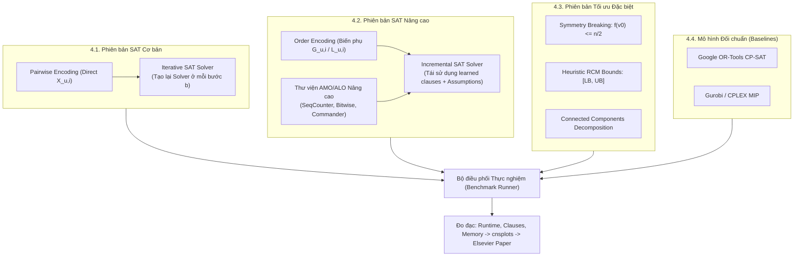

# Bài tập lớn Môn Các vấn đề hiện đại KHMT
# Đề tài: Cực tiểu hóa Băng thông Đồ thị (Bandwidth Minimization Problem – BMP) bằng SAT Solving và So sánh với CP / ILP

---

## MỤC LỤC
1. [Giới thiệu](#1-giới-thiệu)
2. [Mục tiêu](#2-mục-tiêu)
3. [Yêu cầu chung](#3-yêu-cầu-chung)
4. [Các phiên bản triển khai](#4-các-phiên-bản-triển-khai)
   - 4.1. [Phiên bản SAT Cơ bản (Pairwise Encoding & Iterative SAT)](#41-phiên-bản-sat-cơ-bản)
   - 4.2. [Phiên bản SAT Nâng cao (Order Encoding & Incremental SAT)](#42-phiên-bản-sat-nâng-cao)
   - 4.3. [Các thuật toán mã hóa AMO / ALO nâng cao](#43-các-thuật-toán-mã-hóa-amo--alo-nâng-cao)
   - 4.4. [Các cải tiến Tối ưu hóa đặc biệt (Lấy điểm tối đa)](#44-các-cải-tiến-tối-ưu-hóa-đặc-biệt)
   - 4.5. [Các mô hình đối chuẩn (Exact Solvers: CP-SAT, MIP/ILP)](#45-các-mô-hình-đối-chuẩn)
5. [Thiết kế Kiến trúc Hệ thống & Hướng đối tượng (OOP)](#5-thiết-kế-kiến-trúc-hệ-thống--hướng-đối-tượng-oop)
   - 5.1. [Sơ đồ kiến trúc và phân cấp các lớp chính](#51-sơ-đồ-kiến-trúc-và-phân-cấp-các-lớp-chính)
   - 5.2. [Áp dụng các nguyên tắc OOP và Design Patterns](#52-áp-dụng-các-nguyên-tắc-oop-và-design-patterns)
6. [Chất lượng Code, Công cụ và Quy tắc Lập trình](#6-chất-lượng-code-công-cụ-và-quy-tắc-lập-trình)
7. [Hướng dẫn Viết Báo cáo Khoa học (Elsevier) & Trình bày](#7-hướng-dẫn-viết-báo-cáo-khoa-học-elsevier--trình-bày)
8. [Bảng Tiêu chí Chấm điểm Chi tiết (Thang điểm 10 + 1)](#8-bảng-tiêu-chí-chấm-điểm-chi-tiết)

---

## 1. Giới thiệu
Bài tập lớn số 2 nhằm mục đích trang bị cho sinh viên năng lực giải quyết các bài toán tối ưu tổ hợp NP-khó (NP-hard) thông qua các **phương pháp giải chính xác hiện đại (Exact Methods)**, trọng tâm là công nghệ **SAT Solving (Boolean Satisfiability)** và đối chuẩn với **Lập trình ràng buộc (Constraint Programming - CP)** cùng **Quy hoạch tuyến tính nguyên (Integer Linear Programming - ILP/MIP)**.

Bài toán được giao là **Cực tiểu hóa Băng thông Đồ thị (Bandwidth Minimization Problem on Graphs – BMP / BMPG)**:
* Cho đồ thị vô hướng $G = (V, E)$ với $n = |V|$ đỉnh và $m = |E|$ cạnh.
* Tìm một song ánh (phép gán nhãn) $f: V \to \{1, 2, \dots, n\}$ sao cho băng thông lớn nhất trên các cạnh:
  $$B(G) = \min_{f} \max_{(u, v) \in E} |f(u) - f(v)|$$
* **Ý nghĩa thực tế:** BMP có vai trò then chốt trong tính toán khoa học (dồn các phần tử khác 0 của ma trận thưa về sát đường chéo chính để lưu trữ dạng dải băng $O(n \cdot B)$ và tăng tốc giải hệ $Ax = b$ bằng khử Gauss/Cholesky từ $O(n^3)$ xuống $O(n \cdot B^2)$), thiết kế vi mạch VLSI, nén đồ thị web và phương pháp phần tử hữu hạn (FEM).

---

## 2. Mục tiêu
- **Làm chủ kỹ thuật SAT Encoding:** Hiểu sâu và cài đặt chuẩn xác cả 2 trường phái mã hóa: **Pairwise (Direct) Encoding** và **Order Encoding** (dùng biến phụ thứ tự $G$ và $L$).
- **Làm chủ chiến lược tương tác SAT Solver:** Triển khai thành công cả 2 cơ chế: **SAT nhiều lần (Iterative SAT / Binary Search)** và **SAT Gia tăng (Incremental SAT)** với biến giả định (Assumptions).
- **Làm chủ các cấu trúc ràng buộc cardinality:** Ứng dụng các thuật toán mã hóa At-Most-Once (AMO) và At-Least-Once (ALO) nâng cao (*Sequential Counter, Bitwise/Binary, Commander, Product*) để ngăn chặn hiện tượng bùng nổ mệnh đề ($O(n^3)$).
- **Làm chủ các kỹ thuật tối ưu hóa tìm kiếm:** Áp dụng Phá vỡ tính đối xứng (Symmetry Breaking), Heuristic Reverse Cuthill-McKee (RCM) để thu hẹp cận $[LB, UB]$, và phân rã Thành phần liên thông (Connected Components).
- **Đối chuẩn đa nền tảng (Benchmarking):** Xây dựng các solver đối chứng bằng Google OR-Tools CP-SAT, Gurobi MIP / CPLEX để so sánh khách quan về thời gian giải (runtime), bộ nhớ, số biến và số mệnh đề.
- **Trực quan hóa & Công bố khoa học:** Vẽ biểu đồ chuyên nghiệp bằng thư viện `cnsplots`, viết báo cáo khoa học theo chuẩn Elsevier `cas-sc` và duy trì kho mã nguồn minh bạch trên GitHub.

---

## 3. Yêu cầu chung
* **Ngôn ngữ lập trình:** Python 3.10+ (sử dụng thư viện `PySAT` hoặc gọi SAT solver trực tiếp như CaDiCaL, Kissat, Glucose).
* **Môi trường & Quản lý thư viện:** Dự án phải có file quản lý phụ thuộc rõ ràng (`pyproject.toml` hoặc `requirements.txt`). Khuyến khích quản lý bằng công cụ hiện đại (`uv` hoặc `venv`).
* **Dữ liệu thực nghiệm:** Sử dụng tập benchmark chuẩn **Harwell-Boeing Sparse Matrix Collection** (được cung cấp và đối chiếu cận LB/Best trong bài báo của Torres-Jimenez et al., 2015).
* **Tính tái lập (Reproducibility):** Bất kỳ ai clone repository về đều có thể chạy lại thực nghiệm tự động bằng một dòng lệnh duy nhất (`python run_experiments.py`).
* **Định dạng báo cáo:** Biên dịch bằng LaTeX theo mẫu template của nhà xuất bản Elsevier:
  `\documentclass[a4paper,fleqn]{cas-sc}`.

---

## 4. Các phiên bản triển khai



---

### 4.1. Phiên bản SAT Cơ bản
Phiên bản nền tảng tập trung vào việc mô hình hóa trực tiếp bài toán BMP và kiểm tra tính đúng đắn toán học.

#### 4.1.1. Chức năng chính
- Đọc đồ thị / ma trận từ file định dạng chuẩn Matrix Market (`.mtx`) hoặc danh sách cạnh (`.txt`).
- Khởi tạo không gian biến boolean trực tiếp: $X_{u, i} = 1 \iff f(u) = i$ ($1 \le u, i \le n$).
- **Mã hóa các ràng buộc song ánh cơ sở (Pairwise):**
  1. *At-Least-Once (ALO) trên đỉnh:* Mỗi đỉnh nhận ít nhất 1 nhãn:
     $$\bigvee_{i=1}^n X_{u, i} \quad \forall u \in V$$
  2. *Pairwise At-Most-Once (AMO) trên đỉnh:* Mỗi đỉnh nhận tối đa 1 nhãn:
     $$\neg X_{u, i} \lor \neg X_{u, j} \quad \forall u \in V, \ 1 \le i < j \le n$$
  3. *Đơn ánh (Injective AMO):* Hai đỉnh khác nhau không nhận cùng nhãn:
     $$\neg X_{u, i} \lor \neg X_{v, i} \quad \forall 1 \le u < v \le n, \ 1 \le i \le n$$
- **Mã hóa ràng buộc băng thông theo cặp (Pairwise Bandwidth):**
  Với mỗi cạnh $(u, v) \in E$ và mỗi cặp nhãn $(i, j)$ thỏa mãn $|i - j| \ge b$, thêm mệnh đề cấm:
  $$\neg X_{u, i} \lor \neg X_{v, j}$$

#### 4.1.2. Chiến lược giải SAT nhiều lần (Iterative SAT)
- Sử dụng thuật toán Tìm kiếm Nhị phân (Binary Search) trên khoảng $b \in [1, n]$.
- Ở mỗi bước thử giá trị $b$:
  1. Khởi tạo một đối tượng SAT solver mới (ví dụ: `solver = Cadical153()`).
  2. Nạp toàn bộ mệnh đề cơ sở và mệnh đề băng thông ứng với giá trị $b$.
  3. Gọi `solver.solve()`. Nếu kết quả là `SAT`, cập nhật $UB = b - 1$ và tìm nửa dưới; nếu `UNSAT`, cập nhật $LB = b + 1$ và tìm nửa trên.
  4. Hủy đối tượng solver và giải phóng bộ nhớ.

---

### 4.2. Phiên bản SAT Nâng cao
Phiên bản nâng cao áp dụng mô hình toán học tối ưu của bài giảng trên lớp và cơ chế gia tăng để bứt phá hiệu năng.

#### 4.2.1. Triển khai Order Encoding với biến phụ $G$ và $L$
* **Hệ thống biến phụ thứ tự:**
  * Biến $G_{u, i} \in \{0, 1\} \iff f(u) \ge i$ ($u \in V, 2 \le i \le n$). Quy ước $G_{u, 1} \equiv 1$, $G_{u, i} \equiv 0 \ (\forall i > n)$.
  * *(Hoặc biến $L_{u, i} \in \{0, 1\} \iff f(u) \le i$ với $1 \le i \le n-1$).*
* **Mệnh đề tính chất thứ tự:**
  $$\neg G_{u, i} \lor G_{u, i-1} \quad \forall u \in V, \ 3 \le i \le n$$
* **Mệnh đề cầu nối $X \to G$:**
  $$\neg X_{u, i} \lor G_{u, i} \quad (\forall 2 \le i \le n) \quad \text{và} \quad \neg X_{u, i} \lor \neg G_{u, i+1} \quad (\forall 1 \le i \le n-1)$$
* **Mệnh đề kiểm tra băng thông $< b$ siêu ngắn gọn (Chỉ 2 mệnh đề nhị phân cho mỗi cạnh):**
  $$\neg X_{u, i} \lor \neg G_{v, i+b} \quad (\text{với } i + b \le n)$$
  $$\neg X_{u, i} \lor G_{v, i-b+1} \quad (\text{với } i - b + 1 \ge 2)$$

#### 4.2.2. Triển khai Incremental SAT (SAT Gia tăng với Assumptions)
- Khởi tạo SAT solver một lần duy nhất trong toàn bộ vòng đời tìm kiếm.
- Đẩy toàn bộ các mệnh đề bất biến (Song ánh, Thứ tự của $G$, Cầu nối $X \to G$) vào solver.
- Khi kiểm tra giá trị $b$:
  - Tạo một biến kích hoạt $A_b$ (Activation/Assumption literal).
  - Thêm các mệnh đề băng thông có gắn kèm phủ định của biến kích hoạt:
    $$(\neg A_b \lor \neg X_{u, i} \lor \neg G_{v, i+b})$$
    $$(\neg A_b \lor \neg X_{u, i} \lor G_{v, i-b+1})$$
  - Kích hoạt kiểm tra bằng lời gọi: `solver.solve(assumptions=[A_b])`.
- **Lợi thế vượt bậc:** Solver giữ nguyên toàn bộ cây xung đột và các mệnh đề học được (**learned clauses**) qua các lần giải, giúp tốc độ giải ở các bước sau nhanh hơn gấp nhiều lần so với Iterative SAT.

---

### 4.3. Các thuật toán mã hóa AMO / ALO nâng cao
Nhằm khắc phục nhược điểm $O(n^3)$ mệnh đề của Pairwise AMO, hệ thống phải triển khai và so sánh các kỹ thuật mã hóa nâng cao thông qua `pysat.card.CardEnc`:

1. **Sequential Counter Encoding (Sinz, 2005):**
   - Sử dụng biến phụ đếm tích lũy $s_{i, j}$.
   - Số mệnh đề giảm xuống tuyến tính: $O(n)$. Cơ chế Unit Propagation cực mạnh.
2. **Bitwise / Binary Encoding:**
   - Mã hóa chỉ số $i$ thành biểu diễn nhị phân gồm $\lceil \log_2 n \rceil$ biến boolean.
   - Tiết kiệm biến phụ và chỉ sinh $O(n \log n)$ mệnh đề.
3. **Commander Encoding & Product Encoding:**
   - Chia tập biến $n$ phần tử thành các nhóm nhỏ $\sqrt{n}$ để triệt tiêu số mệnh đề bậc 2.
4. **Đánh giá định lượng:** Lập bảng so sánh trực tiếp số biến, số mệnh đề và thời gian sinh CNF giữa các phương pháp trên cùng một ma trận benchmark.

---

### 4.4. Các cải tiến Tối ưu hóa đặc biệt (Đảm bảo Điểm Thưởng & Điểm Tuyệt đối)
Đây là các kỹ thuật nghiên cứu nâng cao giúp solver của nhóm vượt trội hoàn toàn so với các cách cài đặt thông thường:

#### 4.4.1. Phá vỡ tính đối xứng (Symmetry Breaking)
- **Cơ sở lý thuyết:** Ánh xạ đảo ngược nhãn $f'(u) = n + 1 - f(u)$ cho ra băng thông hoàn toàn giống $f(u)$. Không gian tìm kiếm luôn tồn tại tính đối xứng 2 chiều.
- **Cài đặt:** Chọn một đỉnh đặc biệt $v_0$ (ví dụ đỉnh có bậc cao nhất hoặc đỉnh 1) và ép nó nằm ở nửa đầu miền giá trị:
  $$f(v_0) \le \left\lfloor \frac{n}{2} \right\rfloor \iff \neg G_{v_0, \lfloor n/2 \rfloor + 1}$$
- **Hiệu quả:** Cắt giảm tức thì 50% không gian tìm kiếm, loại bỏ hoàn toàn các nhánh duyệt trùng lặp.

#### 4.4.2. Thu hẹp khoảng tìm kiếm $[LB, UB]$ bằng Heuristic
Không tìm kiếm mù quáng trên $[1, n-1]$. Tự động tính toán các cận khởi tạo chặt chẽ:
* **Cận dưới ($LB$):**
  $$LB = \max \left( \left\lceil \frac{\Delta(G)}{2} \right\rceil, \ \left\lceil \frac{n-1}{\text{diameter}(G)} \right\rceil \right)$$
* **Cận trên ($UB$):** Chạy thuật toán tham lam **Reverse Cuthill-McKee (RCM)** trong vài mili-giây (`scipy.sparse.csgraph.reverse_cuthill_mckee`) để làm cận trên ban đầu.
* **Hiệu quả:** Giảm số lần gọi SAT solver từ 10-15 lần xuống chỉ còn 2-4 lần lặp nhị phân.

#### 4.4.3. Phân rã Thành phần liên thông (Connected Components)
- Đối với các ma trận có nhiều thành phần liên thông rời nhau (như phản ánh trong Bảng 5 của bài báo Torres-Jimenez et al., 2015), băng thông của toàn đồ thị bằng băng thông lớn nhất trong các thành phần:
  $$B(G) = \max_{k} B(G_k)$$
- Hệ thống tự động phân tách đồ thị thành các đồ thị con liên thông, giải độc lập và hợp nhất kết quả.

---

### 4.5. Các mô hình đối chuẩn (Exact Baselines: CP-SAT, MIP/ILP)
Để phục vụ mục tiêu so sánh khoa học theo đúng yêu cầu đề bài của Giảng viên:

#### 4.5.1. Mô hình Quy hoạch Tuyến tính Nguyên (ILP / MIP)
Sử dụng mô hình gán nhãn nhị phân chuẩn (Binary Assignment Formulation):
- **Không gian biến:**
  - Biến nhị phân gán nhãn: $X_{u, i} \in \{0, 1\} \quad \forall u \in V, \ i \in \{1, \dots, n\}$ ($X_{u, i} = 1 \iff f(u) = i$).
  - Biến mục tiêu: $B \ge 0 \quad (B \in \mathbb{Z}^+)$.
- **Hàm mục tiêu:** $\min B$.
- **Ràng buộc song ánh (Ma trận Birkhoff):**
  - Mỗi đỉnh nhận đúng 1 nhãn: $\sum_{i=1}^n X_{u, i} = 1 \quad \forall u \in V$.
  - Mỗi nhãn được gán cho đúng 1 đỉnh: $\sum_{u \in V} X_{u, i} = 1 \quad \forall i \in \{1, \dots, n\}$.
- **Tuyến tính hóa ràng buộc băng thông:** Tách $|pos_u - pos_v| \le B$ thành 2 bất phương trình đối xứng với $pos_u = \sum_i i \cdot X_{u, i}$:
  $$\sum_{i=1}^n i \cdot X_{u, i} - \sum_{i=1}^n i \cdot X_{v, i} \le B \quad \forall (u, v) \in E$$
  $$\sum_{i=1}^n i \cdot X_{v, i} - \sum_{i=1}^n i \cdot X_{u, i} \le B \quad \forall (u, v) \in E$$
- **Nhận xét học thuật:** Cực kỳ ít ràng buộc ($2n + 2m$), nhưng khi nới lỏng tuyến tính (LP Relaxation), nghiệm phân số $X_{u, i} = 1/n$ làm $B_{LP} = 0$, dẫn đến cây Branch-and-Bound bị phình to khi $n > 40$.

#### 4.5.2. Mô hình Lập trình Ràng buộc (Constraint Programming - Google OR-Tools CP-SAT)
- **Không gian biến:**
  - Biến nguyên miền rời rạc: $f_u \in \{1, 2, \dots, n\} \quad \forall u \in V$.
  - Biến nguyên mục tiêu: $B \in [LB, UB]$.
- **Hàm mục tiêu:** $\min B$.
- **Ràng buộc song ánh toàn cục:**
  $$\text{AllDifferent}([f_u \mid u \in V])$$
  *(Ứng dụng thuật toán luồng cực đại và thành phần liên thông mạnh của Régin (1994) để lan truyền miền giá trị $O(\sqrt{n} \cdot m)$).*
- **Ràng buộc khoảng cách cạnh:**
  $$|f_u - f_v| \le B \quad \forall (u, v) \in E$$
  *(Cài đặt qua biến trung gian `diff` với `model.AddAbsEquality(diff, f[u] - f[v])` và `model.Add(diff <= bw)`).*
- **Nhận xét học thuật:** CP-SAT kết hợp miền biến rời rạc và ràng buộc toàn cục `AllDifferent` của CP với cơ chế sinh mệnh đề lười (Lazy Clause Generation - LCG) trên nền tảng CDCL của SAT, đạt hiệu năng giải cực nhanh (ví dụ `pores_1` giải trong ~1.07 giây).

---

## 5. Thiết kế Kiến trúc Hệ thống & Hướng đối tượng (OOP)

### 5.1. Sơ đồ kiến trúc và phân cấp các lớp chính

```
                               ┌─────────────────────────┐
                               │       GraphData         │
                               │ - n, edges, adj_matrix  │
                               │ - compute_lb(), rcm_ub()│
                               │ - get_components()      │
                               └────────────┬────────────┘
                                            │ uses
                               ┌────────────▼────────────┐
                               │   <<Abstract Class>>    │
                               │       BaseBMPSolver     │
                               │-------------------------│
                               │ + solve() -> Result     │
                               │ + get_stats()           │
                               └────────────┬────────────┘
                                            │
         ┌───────────────────┬──────────────┴───────┬───────────────────┐
         │                   │                      │                   │
┌────────▼────────┐ ┌────────▼────────┐    ┌────────▼────────┐ ┌────────▼────────┐
│ PairwiseSolver  │ │   OrderSolver   │    │  CPSATSolver    │ │   MIPSolver     │
│ - Direct X_u,i  │ │ - Order G_u,i   │    │ - OR-Tools      │ │ - Gurobi /      │
│ - Iterative/Inc │ │ - Iterative/Inc │    │ - AllDifferent  │ │   CPLEX MIP     │
│ - AMO options   │ │ - Symmetry opt  │    │ - Minimize(bw)  │ │ - Linearized    │
└─────────────────┘ └─────────────────┘    └─────────────────┘ └─────────────────┘
```

#### Chi tiết vai trò từng lớp:
* **`GraphData`**: Chịu trách nhiệm nạp dữ liệu từ file ma trận (`.mtx`, `.txt`), xây dựng cấu trúc danh sách kề, tính toán các độ đo đồ thị (bậc lớn nhất $\Delta$, đường kính graph diameter), phân tách thành phần liên thông và chạy Heuristic RCM.
* **`BaseBMPSolver` (Abstract Base Class)**: Định nghĩa giao diện chung cho tất cả các solver. Cung cấp các phương thức trừu tượng `solve(timeout=None)` trả về đối tượng `SolverResult` chuẩn hóa (chứa: băng thông tối ưu, thời gian giải, số biến, số mệnh đề, trạng thái giải).
* **`PairwiseSolver`**: Kế thừa `BaseBMPSolver`. Triển khai mã hóa Pairwise. Cho phép cấu hình loại AMO (`pairwise`, `seqcounter`, `bitwise`) và chế độ chạy (`iterative` hoặc `incremental`).
* **`OrderSolver`**: Kế thừa `BaseBMPSolver`. Triển khai mô hình Order Encoding dùng biến $G$ (hoặc $L$), tích hợp cơ chế Phá vỡ đối xứng (Symmetry Breaking) và Incremental SAT.
* **`CPSATSolver` & `MIPSolver`**: Kế thừa `BaseBMPSolver`. Triển khai các mô hình CP-SAT và ILP để làm bộ đối chuẩn khách quan.
* **`BenchmarkRunner`**: Lớp quản lý điều phối chạy hàng loạt trên danh sách các ma trận benchmark, ghi nhận log, lưu kết quả ra file `results.csv`.
* **`Visualizer`**: Đọc dữ liệu từ `results.csv`, sử dụng thư viện `cnsplots` để kết xuất các biểu đồ phân tích chuẩn xuất bản (Cactus plot, boxplot, radar chart).

### 5.2. Áp dụng các nguyên tắc OOP và Design Patterns
* **Single Responsibility Principle (SRP):** Tách bạch hoàn toàn giữa việc biểu diễn đồ thị (`GraphData`), sinh mệnh đề CNF (`Encoder`), giải bài toán (`Solver`), và vẽ biểu đồ (`Visualizer`).
* **Open/Closed Principle (OCP):** Hệ thống sẵn sàng mở rộng thêm các thuật toán mã hóa mới (như Staircase Encoding) hoặc các solver mới (như Chuffed, Kissat) mà không cần sửa đổi mã nguồn của `BenchmarkRunner`.
* **Strategy Pattern & Factory Pattern:** Áp dụng Factory để sinh ra solver tương ứng dựa trên cấu hình (`SolverFactory.create("order-incremental", amo="seqcounter")`).

---

## 6. Chất lượng Code, Công cụ và Quy tắc Lập trình
- **Quy ước mã nguồn:** Tuân thủ tiêu chuẩn **PEP 8** của Python. Khai báo kiểu dữ liệu rõ ràng (Type Hints: `def solve(self, timeout: float = 300.0) -> SolverResult:`).
- **Cấu trúc thư mục chuẩn dự án:**
  ```text
  bmp-sat-bench/
  ├── data/                  # Chứa các file benchmark Harwell-Boeing (.mtx)
  ├── docs/                  # Tài liệu đặc tả, hướng dẫn cài đặt và báo cáo LaTeX
  ├── src/
  │   ├── graph.py           # Lớp GraphData và các thuật toán đồ thị
  │   ├── encodings/         # Các module sinh CNF (pairwise, order, amo)
  │   ├── solvers/           # Lớp BaseBMPSolver và các solver kế thừa
  │   ├── runner.py          # Benchmark runner tự động
  │   └── visualizer.py      # Module vẽ biểu đồ với cnsplots
  ├── tests/                 # Unit test kiểm tra tính đúng đắn (pytest)
  ├── results/               # Chứa kết quả CSV, biểu đồ SVG/PNG
  ├── pyproject.toml         # Cấu hình dependency chuẩn
  └── README.md              # Hướng dẫn chạy nhanh 1-click
  ```
- **Kiểm thử tự động (Unit Test):** Sử dụng `pytest` để kiểm tra:
  * Tính song ánh của phép gán nhãn kết quả (tập nhãn $\{f(1), \dots, f(n)\}$ phải là hoán vị của $\{1, \dots, n\}$).
  * Kiểm tra độ lệch $|f(u) - f(v)|$ trên mọi cạnh $(u, v) \in E$ không bao giờ vượt quá băng thông công bố.
- **Trực quan hóa với `cnsplots`:**
  * **Cactus Plot:** Thể hiện số lượng instance giải được theo trục thời gian (so sánh tốc độ giữa Order Incremental SAT, Pairwise SAT, CP-SAT và MIP).
  * **Box Plot:** Phân bố thời gian giải và dung lượng bộ nhớ.
  * **Bar Chart:** So sánh số lượng mệnh đề giữa các kỹ thuật AMO (Pairwise vs SeqCounter vs Bitwise).

---

## 7. Hướng dẫn Viết Báo cáo Khoa học (Elsevier) & Trình bày

### 7.1. Cấu trúc bài báo LaTeX theo mẫu `cas-sc`
Báo cáo nộp thầy phải được soạn thảo hoàn toàn bằng LaTeX theo mẫu template của nhà xuất bản Elsevier (`\documentclass[a4paper,fleqn]{cas-sc}`):
1. **Title & Abstract:** Tóm tắt ngắn gọn bài toán BMP, đóng góp của nhóm (mô hình Order Encoding với biến phụ $G$, cơ chế Incremental SAT, tối ưu AMO và phá vỡ đối xứng), và các kết luận thực nghiệm nổi bật.
2. **1. Introduction:** Bối cảnh bài toán, tầm quan trọng trong đại số tuyến tính tính toán và thiết kế mạch, các công trình liên quan (nhắc đến bài báo của Torres-Jimenez et al., 2015).
3. **2. Problem Formulation:** Định nghĩa toán học hình thức của BMP và bài toán quyết định $BMP < b$.
4. **3. Proposed SAT Encodings:**
   - Trình bày chi tiết toán học của Pairwise Encoding và Order Encoding (biến phụ $G$ và $L$).
   - Phân tích chi tiết các kỹ thuật AMO nâng cao (Sequential Counter, Bitwise).
   - Trình bày các kỹ thuật tối ưu: Phá vỡ đối xứng, Heuristic RCM bounds, phân rã liên thông.
5. **4. Experimental Evaluation:**
   - Mô tả môi trường phần cứng, hệ điều hành, phiên bản phần mềm.
   - Bảng kết quả tổng hợp trên các ma trận benchmark Harwell-Boeing (so sánh với cận LB và Best đã biết).
   - Các biểu đồ trực quan hóa kết xuất từ thư viện `cnsplots`.
   - Phân tích và thảo luận: Tại sao Order Encoding lại vượt trội? Ưu thế của Incremental SAT so với Iterative SAT? So sánh hiệu năng với Google OR-Tools CP-SAT và Gurobi.
6. **5. Conclusion & Future Work:** Kết luận tổng kết và hướng mở rộng.
7. **Data & Code Availability:** Dẫn link GitHub repository chứa toàn bộ mã nguồn sạch và dữ liệu thực nghiệm để người đọc có thể tái lập kết quả.

### 7.2. Chuẩn bị Trình bày và Vấn đáp
- Chuẩn bị slide trình chiếu ngắn gọn (10-12 slides) tập trung vào:
  * So sánh trực quan cơ chế sinh mệnh đề giữa Pairwise và Order Encoding.
  * Giải thích tại sao Incremental SAT giữ lại được learned clauses qua assumption literals.
  * Trình chiếu demo chạy trực tiếp solver trên một ma trận kích thước lớn.
- Sẵn sàng trả lời các câu hỏi chuyên sâu từ giảng viên về: độ phức tạp lý thuyết, ảnh hưởng của các kỹ thuật AMO đến tốc độ Unit Propagation, và nguyên lý hoạt động của solver đối chuẩn.

---

## 8. Bảng Tiêu chí Chấm điểm Chi tiết (Thang điểm 10 + 1)

| Nhóm Tiêu chí | Nội dung Yêu cầu Đánh giá | Điểm | Mức độ |
| :--- | :--- | :---: | :---: |
| **I. Thiết kế Kiến trúc & Toán học** | **Đặc tả toán học hình thức:** Trình bày chính xác 100% hệ thống phương trình và mệnh đề logic CNF cho cả Pairwise và Order Encoding (biến phụ $G/L$). | **1.0** | Bắt buộc |
| | **Thiết kế hướng đối tượng (OOP):** Cấu trúc phân cấp lớp rõ ràng, trừu tượng hóa solver (`BaseBMPSolver`), áp dụng nguyên tắc SOLID và Design Pattern. | **1.0** | Bắt buộc |
| **II. Cài đặt Kỹ thuật Cốt lõi** | **Pairwise Encoding:** Triển khai đúng đắn, sinh mệnh đề chuẩn xác, giải quyết trọn vẹn bài toán. | **1.0** | Bắt buộc |
| | **Order Encoding (với biến phụ $G/L$):** Cài đặt đúng theo mô hình bài giảng của thầy, tối ưu số mệnh đề kiểm tra cạnh chỉ còn 2 mệnh đề nhị phân. | **1.5** | Bắt buộc |
| | **Hai cơ chế giải SAT:** Hoàn thành cả **SAT nhiều lần (Iterative SAT)** và **Incremental SAT** với assumption literals. | **1.5** | Bắt buộc |
| | **Mô hình đối chuẩn (Baselines):** Xây dựng hoàn chỉnh solver đối chứng bằng Google OR-Tools CP-SAT và ILP/MIP. | **1.0** | Bắt buộc |
| **III. Báo cáo & Trực quan hóa** | **Báo cáo khoa học Elsevier (`cas-sc`):** Trình bày chuẩn mực, bố cục chặt chẽ, đầy đủ bảng số liệu và phân tích học thuật. | **1.0** | Bắt buộc |
| | **Minh bạch mã nguồn (GitHub):** Repository có cấu trúc chuyên nghiệp, có hướng dẫn cài đặt và chạy thử rõ ràng. | **0.5** | Bắt buộc |
| | **Trình bày & Trả lời vấn đáp:** Thuyết trình tự tin, làm chủ thuật toán và giải thích cặn kẽ mọi câu hỏi phản biện của thầy. | **1.5** | Bắt buộc |
| **IV. Cải tiến Nâng cao (Điểm thưởng)** | **Triển khai các phương pháp AMO/ALO nâng cao:** Tích hợp Sequential Counter, Bitwise/Binary, Commander qua PySAT và có bảng so sánh số lượng mệnh đề. | **+0.5** | **Tự chọn** |
| | **Tối ưu hóa tìm kiếm & Trực quan hóa:** Cài đặt Phá vỡ đối xứng (Symmetry Breaking), Heuristic RCM bounds, xử lý Thành phần liên thông, và vẽ đồ thị bằng thư viện `cnsplots`. | **+0.5** | **Tự chọn** |
| **TỔNG CỘNG** | *(Điểm tối đa đạt được)* | **10 + 1** | |
